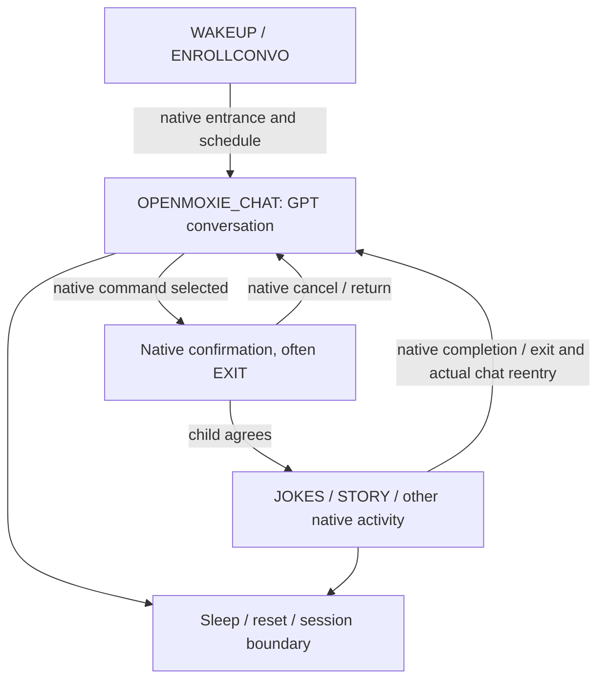

# Autonomous kk/ru conversation plan

Updated: **2026-10-13**.

## Goal

Moxie should wake and speak in the configured Kazakh (`kk`) or Russian (`ru`),
understand the child's actual speech, converse through GPT in OPENMOXIE_CHAT,
and enter native stories/jokes when the robot recognizes those requests.
Native activities must retain coherent speech, questions, choices and visuals.
Custom modules authored directly in kk/ru come later.

## Current pipeline

The arrows describe desired/handled protocol transitions, not server-invented
launches. The firmware decides native launch, confirmation, completion and
return. The schedule advertises OPENMOXIE_CHAT/default as the scheduled module
and chat request. Hardware testing must verify the return path on this robot.

| Mode | Dialogue owner | Spoken output | Human input |
| --- | --- | --- | --- |
| Wake-up | Native entrance | Translate native CloudTTSRequest to selected kk/ru | Existing wake-gate shim returns the entrance trigger |
| Free conversation | GPT in OPENMOXIE_CHAT | Short reply, at most 3 sentences/35 words, REMOTECHAT audio for the live router event | Real STT → faithful English bridge for robot; original recovered for GPT; configured wake-word rule applies |
| Native activity | Native module | Context-aware localization of each native line/chunk, ROBOT audio; native actions and visuals preserved | Real STT continues; short answers need no wake word; bridge preserves native choices |
| Session boundary | Native lifecycle | Any native speech request still receives correlated audio/silence | Recognition disabled outside active chat/native phases; reset clears pending work |

Output language remains `DEFAULT_TTS_LANGUAGE`. The checkout currently defaults
to `ru`; set `kk` explicitly for Kazakh. Automatic output-language switching is
not implemented by these changes. Recognition language is a separate setting.

## Completed implementation

- Removed the suppression flag, GPT replacement of native audio, muting of
  native background speech and GPT generation inside native activity turns.
- Restored normal GLOBAL_RESPONSE for GPT and FALLBACK for native routing.
- Native speech selection cancels pending GPT output for the same event,
  including a late synthesis failure's silence. Interim thinking/curious/silent
  notifications do not cancel GPT.
- Remote notification is not a required precondition for audio. October 12
  shows both notification-before-audio and notification-after-audio ordering.
- Kept STT and original/wire correlation through chat/native handoffs. Native
  short answers work without repeating the wake word.
- Added a bounded per-device recognition queue to handle the three overlapping
  microphone streams observed in the latest capacity-error capture.
- Native localization and input bridging use bounded activity context. Queue
  wait cannot substitute another module's prompt for the question the child
  was answering when their utterance ended.
- Native translation instructions preserve choices, their order, polarity,
  names, facts and sequence while requesting natural child-friendly kk/ru.
  Story chunks retain all their content rather than being shortened to GPT's
  free-chat sentence limit.
- Existing bootstrap, discovery, QR pairing, PCM/marks and puppet behavior are
  retained. No custom content modules have been added.

The server implementation has regression coverage with fake MQTT/providers.
See [NATIVE_CONTENT_POLICY.md](NATIVE_CONTENT_POLICY.md) for the latest test
result, log evidence and protocol limitations, and [AGENTS.md](AGENTS.md) for
component responsibilities, settings, bounds and development invariants.

## Remaining acceptance work

1. **Ordinary free chat:** wake the robot and ask at least five short questions
   in kk and five in ru across the appropriate output-language configurations.
   Confirm audible relevant replies and another listen after each answer.
2. **Native handoff:** ask for a joke/story. If the native module asks for
   confirmation, answer it. Confirm only the native localized dialogue is
   spoken for its turn, with matching activity visuals.
3. **Native choices:** answer yes/no, first/second, and a localized story title
   without a wake word. Confirm faithful English FINAL input and correct native
   branching, with no independent GPT answer layered over it.
4. **Sustained native activity:** allow several chunks and follow-up questions.
   Review kk/ru fluency, consistent names, story continuity and joke meaning.
   Curate language-dependent jokes later if instructions are insufficient.
5. **Return and lifecycle:** finish/exit the activity and verify actual
   OPENMOXIE_CHAT reentry. Repeat after sleep/wake and reconnect; stale replies
   or notifications must not restart old activity state.
6. **Failure recovery:** review correlated silence, genuine provider deadlines,
   empty recognition and overload reasons. Error 66 must no longer be caused
   simply by entering EXIT/STORY/JOKES or by the captured three-listen burst.
   External provider failure and overload beyond configured bounds can still
   produce error 66.

A passing unit suite does not prove physical playback, firmware branching or
translation quality. Fresh robot logs and the operator's observations are the
remaining acceptance evidence. Do not claim completion of that evidence from
transcription text or audio publication alone.

## Later work

- Author custom kk/ru modules such as a fruit activity, with explicit
  ask → listen → acknowledge → next-question state. Reuse this speech/input
  transport while keeping a single dialogue owner.
- Add automatic kk/ru response-language selection if desired; define behavior
  for ambiguous short answers and mixed-language speech first.
- Improve or curate translations for individual native activities using robot
  recordings and reviewed examples.
- Website-triggered action scripts and puppet redesign remain outside the
  current autonomous conversation/native-content task.
