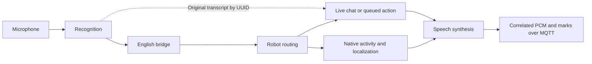

# Live mode

Live mode is the normal Russian/Kazakh conversation path. Moxie connects to
Mosquitto over MQTT/TLS; the agent handles recognition, translation, chat and
speech. HTTP controls queue work but do not carry microphone audio.

## Starting a conversation

Start the project and pair the robot as described in the [README](../README.md).
Cloud TTS enables automatically when `OPENAI_API_KEY` is set; puppet mode starts
disabled. Check the mode and discovered devices:

```bash
curl http://localhost:5053/moxie/devices
curl http://localhost:5053/moxie/puppet
curl http://localhost:5053/status
```

If puppet mode was enabled manually, leave it before using live features:

```bash
curl -X POST http://localhost:5053/moxie/puppet \
  -H 'Content-Type: application/json' -d '{"enabled":false}'
curl -X POST http://localhost:5053/moxie/wakeup
```

Wake Moxie and wait for the entrance sequence to finish. If it asks for
“Moxie, let's go”, speak and pause: the wake-gate shim returns that fixed phrase
at end-of-speech. It does not transcribe actual audio during this entrance.
Free chat starts only when the robot sends a real `OPENMOXIE_CHAT` turn.

## Listening-to-speech pipeline

1. **Listen.** The robot sends framed `zmqSTTRequest` microphone packets with a
   UUID and voice-activity markers: `START_OF_SPEECH`, `SPEECH`, `END_OF_SPEECH`.
   The agent buffers 16 kHz mono PCM16 until the utterance ends.
2. **Recognize.** Cloud recognition produces the original transcript. Invalid
   or silent input is rejected. Free chat normally requires the first word to
   match `STT_WAKE_WORDS`; unrelated input gets an empty FINAL. Native answers
   and an active scripted question do not require the wake word.
3. **Bridge to English.** The original transcript is retained by device/UUID.
   Non-ASCII language input is translated to English for the robot's native
   matcher; ordinary ASCII input passes through. The correlated `zmqSTTResponse`
   contains that English-compatible text. Optional original/language protobuf
   fields are omitted; the original remains available on the server.
4. **Let the robot route.** Firmware selects free chat, a native activity, or a
   session transition. The service does not invent a router turn or treat HTTP
   queue admission as permission to speak.
5. **Build the reply.** In free chat, the model uses the original transcript and
   recent history to reply in `DEFAULT_TTS_LANGUAGE`. An eligible queued line,
   behavior or scripted question can replace that turn's generated reply.
6. **Synthesize and publish.** The agent sends `RemoteChatResponse` plus matching
   `CloudTTSResponse` audio with source `REMOTECHAT_TTS_REQUEST`. Ordinary remote
   replies do not cause a separate native CloudTTSRequest on this firmware.
   Output is 24 kHz mono PCM16 with estimated word/viseme and command marks.
7. **Continue.** The next actual microphone/router exchange advances the
   conversation. A native activity takes ownership of its own branching and
   speech; see [native content](native_content.md).



## Modules and ownership

| Robot module | Agent behavior |
| --- | --- |
| `WAKEUP`, `ENROLLCONVO` | Preserve firmware entrance actions with FALLBACK; localize native speech. Enrollment is configured to be skipped with `max_enroll=0`. |
| `OPENMOXIE_CHAT/default`, `/short` | Handle real free-chat turns and eligible live actions. Both are advertised; the default schedule selects `/default`. |
| Native activities and `EXIT` confirmations | Return FALLBACK without conversational generation; recognize answers and localize the robot's speech. |
| `SESSIONDISMOUNT` | Preserve the native exit interaction; recognize its answer. |
| `WELCOME`, `SLEEP`, `TELEHEALTH`, missing module | Session boundary/unknown handling; ordinary recognition and free-chat generation are disabled. |

A native speech winner invalidates competing remote output for the same event.
Interim animation/silence notifications and command-only speech requests do not
count as a native speech winner. Remote audio does not wait for a selection
notification, because captures show that notification can arrive after audio.
Event IDs, chunk numbers and STT UUIDs are echoed exactly, including valid empty
native/puppet event IDs.

## Language and limits

- `DEFAULT_TTS_LANGUAGE`: output `ru` (default) or `kk`. Input never changes it
  automatically; English is not a supported assistant output language.
- `STT_INPUT_LANGUAGE`: recognition hint, currently `ru`; choose `auto` for mixed
  input. A hint is not a language rejection filter.
- Chat replies are limited to three short sentences and 35 words. Native story
  narration is not shortened to that chat limit.
- Defaults: recognition/bridge 6 s, input translation 2 s, output translation
  4 s, chat 4 s, synthesis 8 s, full reply 12 s. Provider work has four slots;
  a timed-out worker retains its slot until the underlying call finishes.
- Recording is bounded to 30 s, six pending listens per device and sixteen
  globally. Reconnects, new turns and mode changes invalidate stale output.

## Checking progress

Use `/health` for HTTP liveness and `/status` for broker, device freshness,
bootstrap publication and provider configuration. `/ready` returns 503 until its
readiness conditions are met. Provider configuration and bootstrap submission do
not establish provider reachability or firmware readiness (`robot_ready` remains
unknown).

Useful log markers are `STT END`, `STT FINAL`, `remote-chat entered`,
`CloudTTSRequest`, `spoke`, and `published SILENT fallback`. `spoke` means audio
was published, not that playback finished. Firmware `Waiting`/`MarkingUp`
timeouts followed by forced `IDLE` indicate a stall, not activity completion.

Implementation: [recognition](../app/services/speech/recognition/handler.py),
[conversation](../app/services/conversation/remote_chat.py),
[speech output](../app/services/speech/output.py). See
[capabilities](capabilities.md) for speech, behavior and activity commands.
